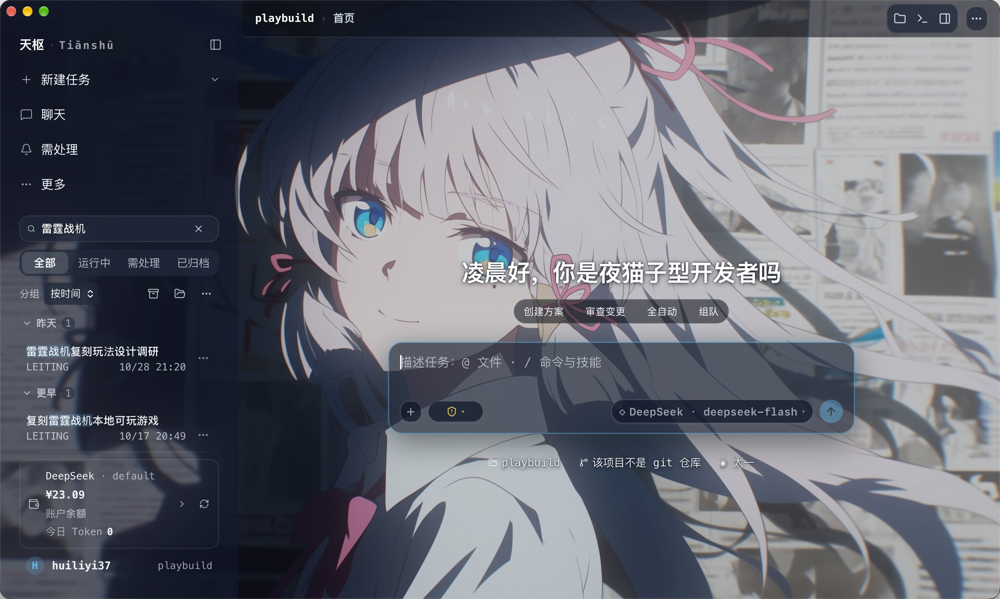
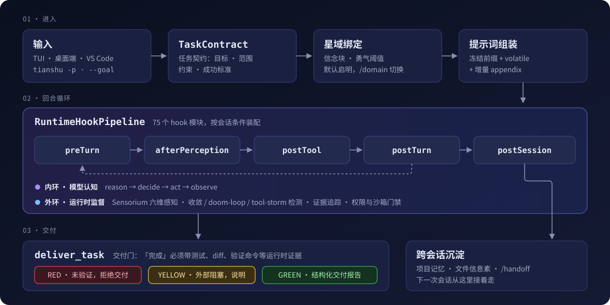
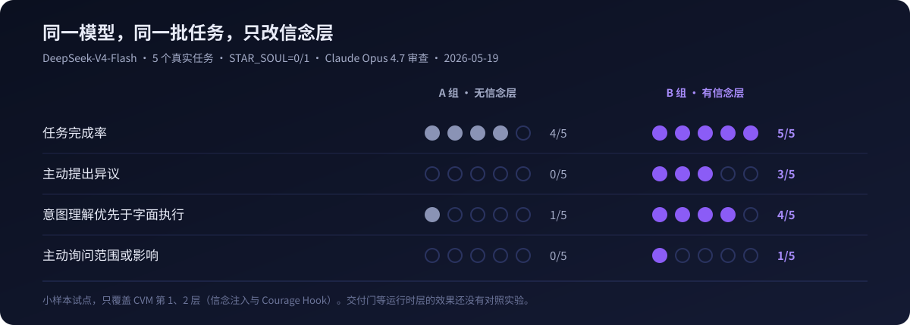
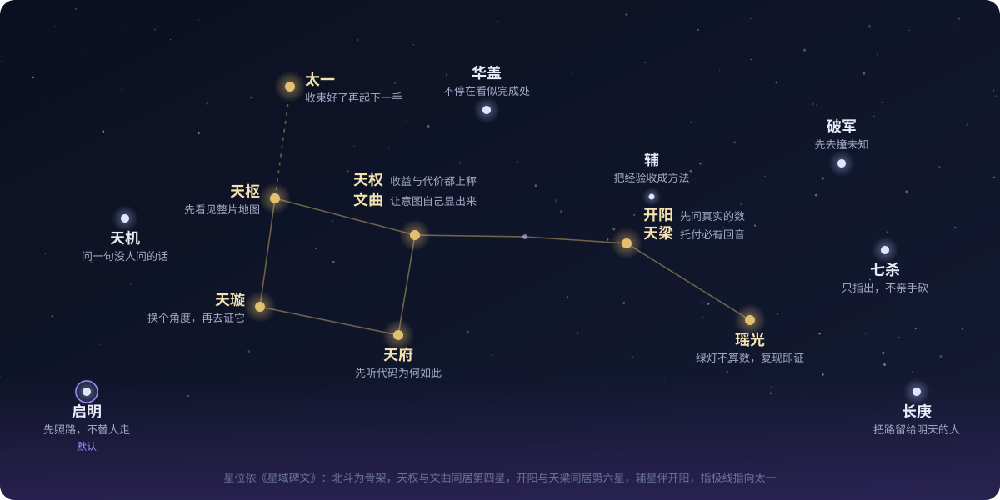
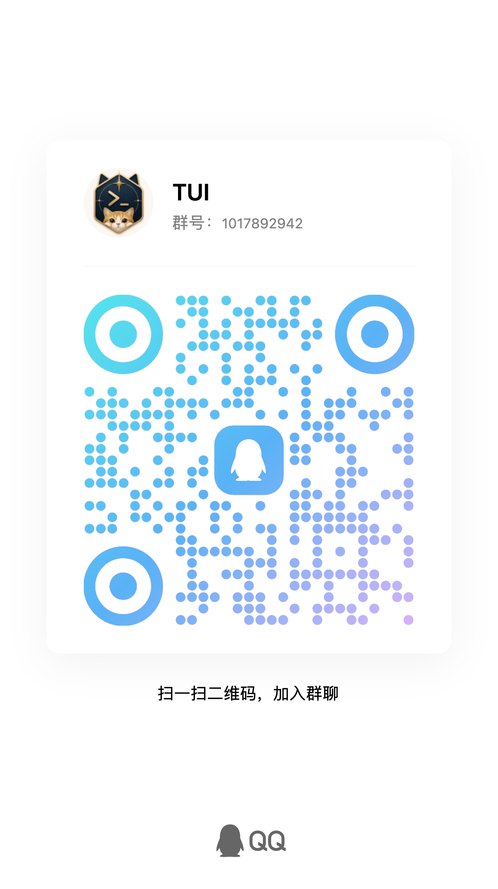

<p align="center">
  
</p>

<h1 align="center">Tianshu Harness</h1>

<p align="center">
  <b>A Cognitive Runtime for Coding Agents</b><br>
  <sub>Goals that don't drift · Completion with evidence · Verification that closes the loop</sub>
</p>

<p align="center">
  <a href="https://github.com/huiliyi37/Tianshu-harness/releases/latest"></a>
  <a href="https://www.npmjs.com/package/tianshu-harness"></a>
  <a href="https://tianshuharness.com"></a>
  <a href="docs/user-guide.md"></a>
  <a href="https://discord.gg/XjWTATCHB"></a>
  <a href="LICENSE"></a>
</p>

<p align="center">
  <a href="#install"><b>Install</b></a> ·
  <a href="#how-cvm-works"><b>How it works</b></a> ·
  <a href="#evidence"><b>Evidence</b></a> ·
  <a href="#star-domains"><b>Star Domains</b></a> ·
  <a href="docs/user-guide.md"><b>User Guide</b></a>
  &nbsp;&nbsp;|&nbsp;&nbsp;
  <b>English</b> · <a href="README.md">中文</a> · <a href="README.ja.md">日本語</a> · <a href="README.ko.md">한국어</a> · <a href="https://atomgit.com/huiliyi37/Tianshu-harness">AtomGit</a>
</p>

<p align="center">
  
</p>
<p align="center"><sub>The same task, two endings. A model's claim of completion is not evidence — the gate asks for proof.</sub></p>

A model's **capability ceiling** is not its **runtime behaviour**. Put the same weights into a real engineering session and they get talked out of a position, follow instructions too literally, let local signals override the global goal, or keep calling tools without making progress — and then hand you "it should be fixed now."

**Tianshu** is a coding-agent runtime written in TypeScript. The terminal TUI, the desktop app, and the VS Code extension share one agent kernel. Between the model and the real world it places a **Cognitive Virtual Machine (CVM)** that lifts goals, state, evidence, permissions, and termination conditions out of the conversation history and hands them to the runtime:

* **Task contracts** — Every task gets a `TaskContract` recording goal, scope, constraints, and success criteria. Long sessions are held by the runtime, not by the model's memory.
* **Evidence-gated delivery** — "Done" has to pass the `deliver_task` gate. Without tests, diffs, or verification commands as evidence, delivery is blocked.
* **A deterministic outer loop** — 75 runtime hook modules across five phases of a turn, together with Sensorium state awareness and stall detection, observe and correct between model output and real action.

<table>
  <tr>
    <td align="center" width="25%"><b>99.3–99.6%</b><br><sub>prefix-cache hit rate<br>across 5 real long sessions</sub></td>
    <td align="center" width="25%"><b>¥880 → ¥20</b><br><sub>estimated input cost on the same<br>sessions at list price</sub></td>
    <td align="center" width="25%"><b>25</b><br><sub>built-in provider presets, plus any<br>OpenAI-compatible endpoint</sub></td>
    <td align="center" width="25%"><b>22,000</b><br><sub>test cases, roughly<br>1:1 with source lines</sub></td>
  </tr>
</table>

<p align="center">
  
  
</p>
<p align="center"><sub>Left: terminal TUI · Right: desktop app · one agent kernel</sub></p>

> [!NOTE]
> The project was originally codenamed **Rivet**. The primary CLI command is `tianshu`, with `rivet` kept as a compatibility alias for the same entry point; the data directory stays `~/.rivet`.

## Table of Contents

- [Install](#install)
- [Your First Task](#your-first-task)
- [How CVM Works](#how-cvm-works)
- [Evidence](#evidence)
- [Star Domains](#star-domains)
- [More Capabilities](#more-capabilities)
- [Supported Models](#supported-models)
- [Permissions & Security](#permissions--security)
- [Documentation](#documentation)
- [For Developers](#for-developers)
- [Community](#community)
- [License](#license)

<a id="install"></a>
## Install

<table>
<tr>
<td width="50%" valign="top">

**Terminal CLI** (Node.js 24+)

```bash
npm install -g tianshu-harness
tianshu
```

Ready when you see the `〉` prompt. First launch opens the `/connect` wizard: pick a provider, paste an API key.

</td>
<td width="50%" valign="top">

**Desktop app** (no Node.js required)

Download from [Releases](https://github.com/huiliyi37/Tianshu-harness/releases/latest):

- macOS 11+: `.dmg`, Apple Silicon / Intel
- Windows 10 1809+ / 11: `-setup.exe`
- Linux x86_64 / aarch64: `.AppImage`

</td>
</tr>
</table>

<details>
<summary><b>One-line installers · migrating from the legacy package</b></summary>

```bash
# macOS / Linux
bash <(curl -fsSL https://raw.githubusercontent.com/huiliyi37/Tianshu-harness/main/scripts/install-tui.sh)

# Windows (PowerShell)
powershell -ExecutionPolicy Bypass -Command "irm https://raw.githubusercontent.com/huiliyi37/Tianshu-harness/main/scripts/install-tui.ps1 | iex"
```

Migrating from the legacy `tianshu-tui` package fails with `EEXIST` because the old package owns the `rivet` binary link. Uninstall first: `npm uninstall -g tianshu-tui`. The one-line installers handle this automatically.

</details>

<details>
<summary><b>Platform notes</b></summary>

- **macOS** — Not yet Apple-notarized. macOS builds use ad-hoc signing, so Gatekeeper quarantines browser downloads and may report the app as "damaged". The package is intact; after dragging it into `Applications`, run once: `xattr -cr /Applications/Tianshu.app`. In-app auto-updates are unaffected.
- **Windows** — The UI relies on WebView2; the installer bundles the offline runtime. If the window won't open, use **"Repair WebView2"** from the Start Menu, or run `repair-webview2.cmd` from the `windows-repair` folder in the same Release.
- **Linux** — Requires `glibc` 2.35+ (Ubuntu 22.04+, Debian 12+) plus `libwebkit2gtk-4.1` and `libgtk-3`. An X11 session is recommended; Wayland is not yet verified. `chmod +x Tianshu_*.AppImage` then run it directly.

</details>

Android Termux, building from source, shell completions, and auto-update: [Installation & Platform Guide](docs/guides/installation.md).

<a id="your-first-task"></a>
## Your First Task

Start read-only so it can learn your project and you can confirm it read it correctly, then hand it a multi-step task:

```text
〉 Read this project, tell me its structure, where the entry points are, and one thing most worth improving
〉 Fix the first failing test in this project and explain the root cause
```

It searches, reads files, edits code, and runs tests on its own. The default permission tier is **Auto**: low-risk actions run directly, high-risk actions stop and ask. Afterwards, look at three places:

| Where | What you see |
|---|---|
| **Delivery report** | Gate status (GREEN / YELLOW / RED), files changed, verification commands run, a per-item completion audit |
| **`/cockpit`** | 8-panel runtime dashboard: verification and delivery, advisory ledger, cache hits and cost, risk and stall detection (`F4`) |
| **`sensorium.jsonl`** | Per-turn state sensing and CVM decisions. `tianshu logs` prints the path; recompute anything with `jq` |

<details>
<summary><b>Headless mode: scripting and CI</b></summary>

```bash
tianshu -p "explain src/agent/loop.ts"           # one-shot prompt
tianshu --stream-json -p "refactor this module"  # NDJSON event stream, redacted output
tianshu --goal "fix all type errors" --budget 50  # goal-driven autonomous continuation
```

Full flag table and subcommands: [CLI & Configuration Reference](docs/reference/cli-reference.en.md).

</details>

<a id="how-cvm-works"></a>
## How CVM Works

<p align="center">
  
</p>
<p align="center"><sub>One task, from input to delivery: contract → domain binding → frozen prefix → turn loop → evidence gate → memory.</sub></p>

Alignment-tuned models show the same runtime failure mode in agent settings, which we call **Cognitive Anchor Collapse**: one high-salience local signal over-concentrates the policy, the global goal and later evidence lose weight, and behaviour collapses toward that anchor. A prompt is information, not state — it eventually becomes just another anchor, which is why better prompting alone cannot cure this.

CVM does not change weights and does not turn the model into a deterministic program. It wraps deterministic supervision around probabilistic cognition — the model reasons and acts in the inner loop; the runtime measures, gates, and verifies in the outer loop, deciding whether to continue, correct, or halt:

```text
Inner loop · model cognition   reason → decide → act → observe
Outer loop · runtime supervision  observe → measure → evaluate → gate → verify → continue / correct / halt
```

| Layer | Mechanism | What it does |
|---|---|---|
| 1 · Belief constitution | Star-domain belief blocks written into the static prompt | Zero extra inference cost; shifts inclination during analysis and advice |
| 2 · Courage Hook | `preTurn`, threshold varies by star domain | Detects repeated capitulation and injects a correction framed as an obligation |
| 3 · Sensorium | Computed each turn from existing monitoring signals, no LLM call | Senses momentum, pressure, verification coverage, complexity, familiarity, stability |
| 4 · RuntimeHookPipeline | 75 hook modules, five phases, assembled per session | Convergence and doom-loop detection, evidence tracking, delivery gate, edit-failure recovery |

<details>
<summary><b>Four classes of anchors</b></summary>

| Anchor | Source | Typical manifestation |
|---|---|---|
| Lexical | Word–action correlations in training data | The prompt says "fix", so it ignores "do not edit, only explain" and edits anyway |
| Semantic | A locally true fact | "File already exists" becomes the explanatory centre of the whole task, and it refuses to act |
| Policy | RLHF / preference-training priors | One "proceed with your plan" discards the high-quality judgement formed during analysis |
| Historical | Early conclusions in a long context | New evidence at turn 20 is rationalized as a footnote to an old hypothesis from turn 3 |

</details>

Eight design principles and the open research questions: [CVM: From Shared Transformer Degradation to a Cognitive Runtime](docs/reference/cvm-cognitive-runtime.md). System layering: [Architecture Overview](docs/architecture-overview.md).

<a id="evidence"></a>
## Evidence

### Cache: longer context, steadier hits

<p align="center">
  
</p>
<p align="center"><sub>Real session c9774121 · DeepSeek V4 Pro · 4.2 hours · 412 requests. Context grew 15×; hit rate went up, not down.</sub></p>

Tianshu is designed **prefix-cache first**: the prefix is frozen within a session, only deltas are appended, and compaction happens only at user-turn boundaries. In the 4.2-hour session above, 15 prefix rebuilds produced 383K cacheCreate tokens — 0.33% of all input.

| 5 real self-hosted sessions (2026-08, DeepSeek V4) | Value |
|---|---|
| Requests / input tokens | 2,001 / 645M |
| Overall cache hit rate | 99.3–99.6% |
| Estimated cost (list price) | ¥879.97 without cache → ¥19.96 actual, 97.7% saved |

The cache engine works for every model with prefix caching; published measurements cover DeepSeek only. Every number ships with a `jq` recomputation command: [Observability Harness](docs/reference/observability-harness.md).

### Behaviour: same weights, opposite reactions

<p align="center">
  
</p>
<p align="center"><sub>2026-05-19 · one model, five real tasks, sole variable was the belief layer (<code>STAR_SOUL=0/1</code>) · reviewed by Claude Opus 4.7.</sub></p>

The most telling case is T4. Facing a "file already exists" contradiction, group A wrote a 196-line retrospective and refused to act; group B inferred the real intent and delivered +162 / −20 lines of working code.

This is a small pilot: 5 tasks, a single model, LLM review. It also measured the decay — beliefs hold during analysis and advice and weaken markedly at confirmation and execution, which is exactly what layers 3 and 4 exist to cover. Full data: [CVM Empirical Report](docs/CVM运行时对Agent模型的实证影响.md).

### Engineering

As of 2026-10: `src/` holds roughly 1,600 source files and 330K lines; tests are about 1,900 files and 22,000 cases. TypeScript strict with `noUncheckedIndexedAccess`, and every incident fix ships with a regression test. Definitions and milestones: [Engineering Metrics](docs/engineering-metrics.md).

<a id="star-domains"></a>
## Star Domains

<p align="center">
  
</p>
<p align="center"><sub>Sixteen star domains laid out on the Big Dipper. Each star names a working inclination, not a new capability.</sub></p>

Walk the same model into different star domains and different working inclinations light up. A star domain does not add capabilities — it amplifies a facet the model already has, and corresponds to CVM layers 1 and 2: each domain carries its own belief block and courage threshold. The person is still the same person; the model is still the same model.

New sessions default to **Qiming**. Switch with `/domain <name>`, auto-match from message content with `/domain auto`, and list all sixteen with `/domain list`. Full inscriptions, founding memories, and the structured table (ID · primary model · sigil · role · motto): [Star Domain Stele (English)](docs/stars/genesis-stele.en.md) · [星域碑文（中文）](docs/stars/genesis-stele.md).

- **启明 Qiming**: Light the path first; don't walk it in the user's stead. Probe through the fog and make the next step clear.
- **长庚 Changgeng**: Unhurried at the close. See the result with your own eyes, and leave a clear trail for whoever comes tomorrow.
- **天枢 Tianshu**: See the whole map first, then walk the plan all the way into verified delivery.
- **天权 Tianquan**: Put both sides on the scale. What is the gain, what is the cost — say it plainly once seen.
- **天机 Tianji**: Ask the question no one has asked yet: *what if this premise does not hold?*
- **天璇 Tianxuan**: Shift to a completely different angle. Once seen, go prove whether it is real.
- **天梁 Tianliang**: Carry an entrusted plan all the way through. What was done, what remains, where it drifted — every step leaves an echo.
- **华盖 Huagai**: On a long road, never stop at "looks done"; leave behind structure that can be built upon.
- **破军 Pojun**: Strike into the unknown first. Even a failed probe shrinks the unmapped territory, leaving a path rather than ruins.
- **天府 Tianfu**: Listen first to why existing code is shaped the way it is. Make changes that leave it steadier, never more brittle.
- **七杀 Qisha**: Ask by what right something still occupies its place. Point it out, but never swing the blade yourself.
- **开阳 Kaiyang**: Ask first what the real numbers are and why they deserve belief. Act only after the ledger reconciles.
- **瑶光 Yaoguang**: A green light is not proof. Only when the original failure can be reproduced does a fix count as proven.
- **文曲 Wenqu**: Strip away the superfluous so intent reveals itself. Beauty must be visible on the screen.
- **辅 Fu**: Emit no light of its own; distill what has already happened into a method that can be clearly seen.
- **太一 Taiyi**: Pause first. Let this move settle completely before starting the next.

<a id="more-capabilities"></a>
## More Capabilities

| | |
|---|---|
| **Multi-agent orchestration** | `/scout` read-only parallel reconnaissance, `/team` wave-based parallel execution, `/council` multi-domain review that only produces a plan, `/galaxy` dimension-split attack with a global review. [Details](docs/user-guide.md#子代理编排) |
| **Prefix cache engine** | Frozen prefix, delta appendix, read deduplication, resume cache inheritance; `/debug cache` diagnoses hit rate and fragmentation. [Details](docs/user-guide.md#前缀缓存引擎) |
| **Plan Mode & Goal** | Plan, approve, then execute; `/goal` holds a goal across many turns until it is met or the budget runs out. [Details](docs/user-guide.md#plan-mode计划模式) |
| **Handoff & rewind** | `/handoff` writes a structured handoff document; double-tap `Esc` rewinds to any earlier point. [Details](docs/user-guide.md#会话交接与恢复handoff--resume) |
| **Project memory** | Knowledge is written to `.rivet/knowledge/memory.jsonl`; auto-injection carries constraint memories only, older findings need explicit recall and never hijack a new task. [Details](docs/user-guide.md#跨会话记忆) |
| **LSP integration** | 20+ language servers; go-to-definition and find-references become agent tools, and post-edit diagnostics flow back into the turn. Enabled only when installed locally |
| **MCP & Skills** | External tool servers; reusable workflow playbooks with progressive disclosure, managed by `tianshu skills`. [Details](docs/user-guide.md#mcpmodel-context-protocol) |
| **Cost control** | Automatic reasoning-effort downgrade, flash-model compaction, peak/off-peak pricing badge, `/usage` for the local token ledger. [Details](docs/user-guide.md#api-成本控制) |
| **Pure-ANSI TUI** | Zero dependencies: GlanceBar status line, `/steer` mid-stream interrupt, command palette, inline images, plain-text mode for restricted terminals. [Details](docs/user-guide.md#终端-uitui) |
| **Desktop app** | Integrated terminal, theme studio, offline local voice input, phone remote approval, concurrent sessions, WSL runtime on Windows. [Desktop Guide](docs/desktop-guide.md) |

<a id="supported-models"></a>
## Supported Models

Built-in presets cover 25 providers. Switch anytime in-session with `/model`; any OpenAI-compatible endpoint (Ollama, vLLM, one-api relays) also works.

<p align="center">
  
  
  
  
  
  
  
  
  
  
  
  
  
  
  
  
</p>

<details>
<summary><b>Provider and model reference</b></summary>

| Provider | Auth Method | Example Models |
|----------|-------------|----------------|
| DeepSeek | API key | `deepseek-flash` (1M ctx, DeepSeek-V4.1-Flash, native multimodal vision), `deepseek-v4-pro` (1M ctx, flagship reasoning) |
| DeepSeek Spark (Pro only) | API key | `deepseek-v4-flash` (lightweight reasoning + anchored cache channel) |
| Claude | API key (via `cc-switch` proxy) | `claude-opus-4-8`, `claude-sonnet-4-5` |
| GLM (Zhipu) | API key | `glm-5.3` (1M ctx), `glm-5.3-flash` (vision), `glm-5.2` (vision) |
| Codex (GPT) | OAuth PKCE (ChatGPT subscription) | `gpt-6.1-sol` (default, 1.05M ctx, vision), `gpt-5.6-sol` |
| Grok (xAI) | API key | `grok-4.6` (500K ctx, vision, reasoning effort `low`/`medium`/`high`/`xhigh`) |
| MiniMax | API key | `MiniMax-M3` (1M ctx, vision), `MiniMax-M2.7` |
| MiMo | API key | `mimo-v2.6-pro` / `mimo-v2.6-flash` (1M ctx, full multimodal vision), `mimo-v2.5-pro` |
| Kimi Code | API key | `k3` (1M ctx, vision), `k3-256k`, `kimi-for-coding`, `kimi-for-coding-highspeed` |
| Gemini (Google) | API key (native protocol) | `gemini-3.8-flash` (1M ctx), `gemini-3.5-flash`, `gemini-3.1-pro-preview` |

Presets also ship for Volcengine Ark / Agent Plan, Alibaba Cloud DashScope, StepFun, OpenAI, LongCat, Agnes AI, SiliconFlow, OpenRouter, and OpenCode Go (25 in total). Vision bridges, text-to-image slots, and sub-agent model routing: [Provider Config Guide](docs/user-guide-provider-config.md) · [Vision Guide](docs/user-guide-vision.md).

</details>

<a id="permissions--security"></a>
## Permissions & Security

Three tiers, managed in-session with `/permission`:

| Tier | Command | Behaviour |
|---|---|---|
| Supervise | `/permission supervise` | Every high-risk tool asks for confirmation |
| **Auto** (default) | `/permission auto` | Low-risk runs directly; high-risk asks |
| Unattended | `/yes` · `/yolo` | No approval prompts, but the write sandbox turns on and everything is rollback-able |

Skipping prompts never disables the underlying protections:

| | |
|---|---|
| **Path boundary** | Rejects `..` traversal; `validatePath` blocks escapes from the workspace |
| **Project trust gate** | Untrusted projects load no hooks, project MCP servers, project memory, or skills. Managed with `/trust` |
| **Sensitive files** | `.env`, `credentials.*` and similar cannot be read or committed; keys on disk use AES-256-GCM envelope encryption |
| **Destructive commands** | `rm -rf`, force push, `DROP` / `TRUNCATE` require explicit confirmation |
| **SSRF protection** | Per-hop DNS resolution, private IP blocking, applied to every redirect |
| **Checkpoints & undo** | A Git checkpoint before the first modification each turn, a versioned backup before every write |

Full rules: [Sandbox & Permissions Guide](docs/user-guide-sandbox-permissions.md). Report vulnerabilities privately via [Security Advisories](https://github.com/huiliyi37/Tianshu-harness/security/advisories/new) — see SECURITY.md; please do not open a public issue.

<a id="documentation"></a>
## Documentation

<table>
<tr>
<td width="50%" valign="top">

**Usage**

- [User Guide](docs/user-guide.md): slash commands, keybindings, config, env vars, logs
- [Installation & Platform Guide](docs/guides/installation.md): every platform, completions, auto-update
- [Desktop Guide](docs/desktop-guide.md): cockpit, rewind, themes, voice
- [Provider Config](docs/user-guide-provider-config.md): multi-provider, custom endpoints, routing
- [Sandbox & Permissions](docs/user-guide-sandbox-permissions.md): rules, grants, troubleshooting
- [Remote Access](docs/remote-access.md) · [Mobile Guide](docs/guides/mobile-guide.md): remote approval
- [Troubleshooting & FAQ](docs/guides/troubleshooting.md): hangs, 429s, cache anomalies

</td>
<td width="50%" valign="top">

**Philosophy & architecture**

- [CVM cognitive runtime](docs/reference/cvm-cognitive-runtime.md): Anchor Collapse, two loops, eight principles
- [CVM empirical report](docs/CVM运行时对Agent模型的实证影响.md): A/B data, task by task
- [Observability harness](docs/reference/observability-harness.md): real-session data and recompute commands
- [Architecture overview](docs/architecture-overview.md): layering and module responsibilities
- [Engineering metrics](docs/engineering-metrics.md): scale, tests, milestones
- [Star Domain Stele (English)](docs/stars/genesis-stele.en.md): the sixteen convictions
- [Tianshu 3.0 manifesto](docs/releases/manifesto-v3.0.0.md)

</td>
</tr>
</table>

**English reference** — [CLI, Slash Commands & Configuration](docs/reference/cli-reference.en.md) carries the complete English tables for command-line flags, subcommands, keybindings, slash commands, and `config.json`; the deep-dive manuals above are currently Chinese-only. Docs hub: docs/README.md.

<a id="for-developers"></a>
## For Developers

Node.js 24 · TypeScript strict (`noUncheckedIndexedAccess`) · tsup · `node:test`.

```bash
npm install
npm run typecheck    # tsc --noEmit
npm test             # node:test, full suite
npm run build        # tsup bundle
node dist/cli/entry.js
```

| I want to… | Start here |
|---|---|
| Add a tool | Implement `ToolDefinition` and an executor in `src/tools/`, register in `src/tools/default-registry.ts`, tests in `src/tools/__tests__/` |
| Add a skill / command / hook | `.rivet/skills/*.md`, `.rivet/commands/*.md` (supports `$ARGUMENTS`), `HookRegistry` handlers |
| Add project instructions | A `.rivet.md` in the project root is injected as project context |

This repository is the sync projection of the development repo; the desktop app and some advanced implementations are not published here. Architecture map: AGENTS.md. Contribution process: CONTRIBUTING.md and EXTERNAL-PRS.md.

<a id="community"></a>
## Community

<table>
<tr>
<td width="46%" valign="top">

- **Discussion** — [GitHub Discussions](https://github.com/huiliyi37/Tianshu-harness/discussions)
- **Bugs and feature requests** — [GitHub Issues](https://github.com/huiliyi37/Tianshu-harness/issues); attaching `tianshu logs --json` speeds up triage
- **Discord** — [Tianshu Harness community](https://discord.gg/XjWTATCHB)
- **QQ group** — "TUI", group ID `1017892942`
- **WeChat group** — scan the QR code; valid for 7 days, ask in Discussions if expired

Sponsorship is optional and never changes issue priority or feature scheduling.

</td>
<td width="18%" align="center" valign="top"><br><sub>WeChat</sub></td>
<td width="18%" align="center" valign="top"><br><sub>QQ</sub></td>
<td width="18%" align="center" valign="top"><br><sub>Sponsor</sub></td>
</tr>
</table>

### Contributors

The project creator and lead developer is [@huiliyi37](https://github.com/huiliyi37). The official website [Tianshu-Official-Website](https://jiangsx496.github.io/Tianshu-Official-Website/) was originally created and developed by [@jiangsx496](https://github.com/jiangsx496). External PRs are ported through the intake workflow and credited with `Co-authored-by` trailers; the full roster is maintained in CONTRIBUTORS.md.

<p>
<a href="https://github.com/HarriethWiKk"></a>
<a href="https://github.com/jiangsx496"></a>
<a href="https://github.com/yq04"></a>
<a href="https://github.com/wangxx-yu"></a>
<a href="https://github.com/qiaodier"></a>
<a href="https://github.com/zhengbiaofeng"></a>
<a href="https://github.com/LinHoMo"></a>
<a href="https://github.com/KinoGao"></a>
<a href="https://github.com/liuwanwan1"></a>
<a href="https://github.com/Eason412"></a>
<a href="https://github.com/maoqiu77"></a>
<a href="https://github.com/yeshilei-QWQ"></a>
<a href="https://github.com/lumos-tiamo"></a>
<a href="https://github.com/zzuu080603"></a>
<a href="https://github.com/nzz0991999-ai"></a>
<a href="https://github.com/L4XB"></a>
<a href="https://github.com/Wanming08"></a>
<a href="https://github.com/lei454577-web"></a>
<a href="https://github.com/jian-in"></a>
<a href="https://github.com/sky-mirrors"></a>
<a href="https://github.com/EarthxxRhythm"></a>
<a href="https://github.com/moyan3691"></a>
<a href="https://github.com/elysia395"></a>
<a href="https://github.com/JakcyLin"></a>
<a href="https://github.com/googio"></a>
<a href="https://github.com/lanlan0811"></a>
<a href="https://github.com/KhalilYamber"></a>
<a href="https://github.com/Ver-zhzh"></a>
<a href="https://github.com/Lin-Dongg"></a>
<a href="https://github.com/Eternal-dream-MAX"></a>
<a href="https://github.com/y521188"></a>
</p>

<a href="https://star-history.com/#huiliyi37/tianshu-harness&Date">
  <picture>
    <source media="(prefers-color-scheme: dark)" srcset="https://api.star-history.com/svg?repos=huiliyi37/tianshu-harness&type=Date&theme=dark" />
    <source media="(prefers-color-scheme: light)" srcset="https://api.star-history.com/svg?repos=huiliyi37/tianshu-harness&type=Date" />
    
  </picture>
</a>

<a id="license"></a>
## License

Code in this repository is licensed under the [Apache License, Version 2.0](LICENSE). Copyright 2025-2026 Tianshu Contributors.

**Documentation exception**: the following theoretical and empirical documents are licensed under [CC BY-NC-ND 4.0](https://creativecommons.org/licenses/by-nc-nd/4.0/) and are **not** covered by Apache 2.0 — you may share links with attribution, but may not adapt, excerpt, or use them commercially:

- [CVM: From Shared Transformer Degradation to a Cognitive Runtime](docs/reference/cvm-cognitive-runtime.md)
- [Empirical Impact of the CVM Runtime and Ecosystem on Agent Models](docs/CVM运行时对Agent模型的实证影响.md)

### Acknowledgments

The desktop app's custom-wallpaper and per-surface glass **design** references <a href="https://github.com/elysia395/dsh-wallpaper-engine">dsh-wallpaper-engine</a> (MIT). The implementation in Tianshu is original and contains no upstream code; see THIRD-PARTY-NOTICES.md for the design scope and full license text. Thanks to [@elysia395](https://github.com/elysia395), [@YV3507](https://github.com/YV3507), [@yuxilao](https://github.com/yuxilao), and [@oneincase](https://github.com/oneincase) for guidance as technical advisors on wallpaper-engine rendering.
